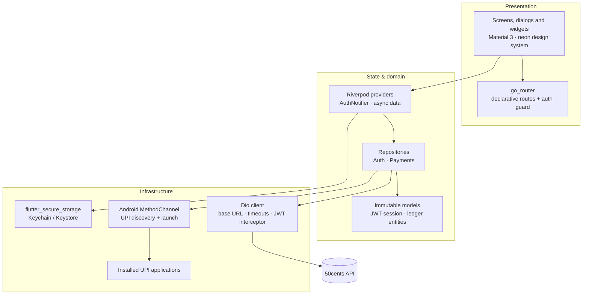
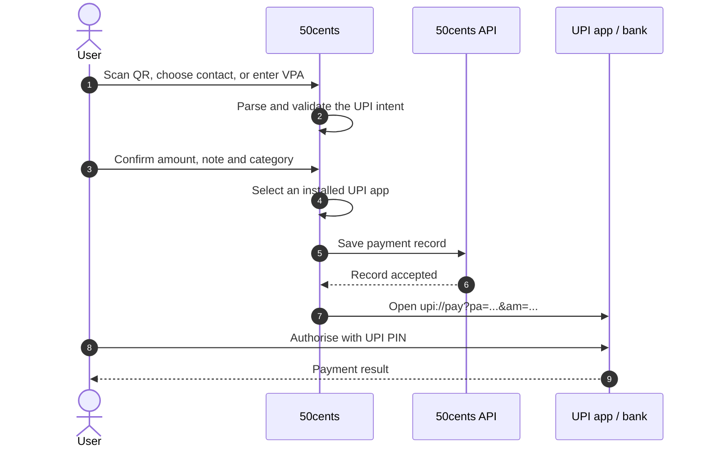

<div align="center">


# 50cents

**A focused, privacy-first UPI companion for everyday payments.**

Scan a QR, pick a contact, or enter a UPI ID — then finish the payment in the app you already trust.

<!-- [](https://github.com/SabarishAV/50cents/actions/workflows/ci.yml) -->
[](https://flutter.dev)
[](https://dart.dev)
[](#platform-support)
[](https://riverpod.dev)
<!-- [](pubspec.yaml) -->
<!-- [](#contributing) -->

</div>

---

## Overview

**50cents** is a Flutter application that makes UPI payments simpler without ever touching your money. It is a **payment redirect layer**, not a payment processor: the app discovers the UPI apps installed on your device, builds a standards-compliant `upi://pay` intent, and hands it off to the app you choose. Your bank credentials and UPI PIN never enter 50cents.

The app pairs that payment flow with a personal ledger, so every payment you initiate — or record manually — is captured with its amount, payee, category, and note.

> **Why "50cents"?** Small, everyday payments deserve a tool that is just as small and fast. No wallets, no stored balances, no detours.

### Design goals

- **Trust by subtraction** — do not handle money, credentials, or PINs.
- **Speed to pay** — a few taps from launch to a populated UPI intent.
- **Clarity after the fact** — a ledger that makes spending understandable.
- **Boring reliability** — explicit states, defensive parsing, graceful fallbacks.

---

## Table of contents

- [Overview](#overview)
- [Features](#features)
- [Architecture](#architecture)
- [Tech stack](#tech-stack)
- [Project structure](#project-structure)
- [Getting started](#getting-started)
- [Configuration](#configuration)
- [API reference](#api-reference)
- [Quality & testing](#quality--testing)
- [Build & release](#build--release)
- [Security & privacy](#security--privacy)
- [Platform support](#platform-support)
- [Roadmap](#roadmap)
- [Contributing](#contributing)
- [License](#license)
- [Acknowledgements](#acknowledgements)

---

## Features

### Pay without friction

- **Scan any UPI QR** with the camera, or pick a QR image from the gallery.
- **Pay a contact** — search the address book and prefill their number.
- **Pay a phone number** — the app builds the conventional `number@upi` intent.
- **Pay any UPI ID (VPA)** — manually enter a payee address.
- **Choose your app** — detected UPI apps appear with their real names and icons; the last used app is preselected.
- **Direct intents** — on Android the payment is routed to exactly the chosen package, with the system chooser as a fallback.
- **Safe handoff** — the amount and note are reviewed in 50cents before the UPI app opens.

### Keep a useful ledger

- **Automatic records** — initiated payments are saved to your account before handoff.
- **Manual entries** — log payments made outside the app, including credits and debits.
- **Smart categories** — the backend predicts a category from the payee and note, and you can override it.
- **History with context** — filter by this month, last 3 or 6 months, or a custom range; separate debits and credits; paginate results.
- **Period summaries** — total credit, total debit, and net movement for the selected range.
- **Record details** — inspect, edit, or delete any entry.

### Account and security

- **Email or username sign-in** with JWT sessions.
- **Google Sign-In** via a server-issued ID token.
- **OTP-based password reset** — no password is ever stored on the device.
- **Change email and password** from the profile, both confirmed by OTP.
- **Account deletion** with OTP confirmation and immediate session revocation.
- **Encrypted session storage** in the platform keystore/keychain.
- **Auth-aware routing** — protected screens are unreachable without a valid, unexpired session.

### Craft

- **Feature-first architecture** with clear data/domain/presentation boundaries.
- **Typed async state** through Riverpod providers.
- **Reactive navigation** via `go_router` redirects.
- **A small design system** — neon palette, grid background, shared inputs, buttons, and payment widgets.
- **Static analysis and formatting enforced** locally and in CI.

---

## Architecture

50cents follows a **feature-first, layered architecture**. Each feature owns its models, repository, providers, and UI. Cross-cutting concerns live in `core/`, and dependencies point inward — widgets never talk to HTTP directly.



### Pay flow



### Architectural decisions

| Concern | Decision | Rationale |
| --- | --- | --- |
| State | Riverpod `Notifier` + `FutureProvider` | Testable, composable, no `BuildContext` coupling. |
| Navigation | `go_router` with a single redirect guard | Auth is enforced in one place, not per screen. |
| Networking | Dio with an interceptor | Centralised auth header, timeouts, and error mapping. |
| Error model | `ApiException` normalisation | Backend field errors reach forms as-is. |
| Session | JWT + decoded claims in secure storage | Instant UI hydration without an extra API call. |
| Platform APIs | Narrow MethodChannel bridge | Android app discovery stays native and fast. |
| UI | Shared neon widgets and tokens | Consistent visual language with low duplication. |

---

## Tech stack

| Layer | Technology | Purpose |
| --- | --- | --- |
| Framework | [Flutter](https://flutter.dev) 3.47 · Dart 3.13 | Cross-platform UI and tooling |
| State | [Riverpod](https://riverpod.dev) | Dependency injection and reactive state |
| Routing | [go_router](https://pub.dev/packages/go_router) | Declarative navigation and auth redirects |
| Networking | [Dio](https://pub.dev/packages/dio) | HTTP client with interceptors |
| Storage | [flutter_secure_storage](https://pub.dev/packages/flutter_secure_storage) | Encrypted token and session persistence |
| Auth | [google_sign_in](https://pub.dev/packages/google_sign_in) | Federated Google sign-in |
| QR | [mobile_scanner](https://pub.dev/packages/mobile_scanner) · image_picker | Live camera and gallery scanning |
| Contacts | [flutter_contacts](https://pub.dev/packages/flutter_contacts) | Optional address book picker |
| Linking | [url_launcher](https://pub.dev/packages/url_launcher) | UPI intent handoff |
| Config | [flutter_dotenv](https://pub.dev/packages/flutter_dotenv) | Build-time environment values |
| Quality | flutter_lints · dart_husky · GitHub Actions | Analysis, hooks, and CI |

---

## Project structure

```text
50cents/
├── lib/
│   ├── main.dart                  # Bootstrap: env loading + ProviderScope
│   ├── app.dart                   # Router, auth guard, theme, localization
│   ├── core/
│   │   ├── config/                # Typed .env access
│   │   ├── network/               # Dio client and ApiException mapping
│   │   ├── storage/               # Encrypted session persistence
│   │   ├── theme/                 # Colors, typography, input decoration
│   │   ├── utils/                 # JWT payload decoding
│   │   └── widgets/               # Logo, grid background, neon buttons
│   └── features/
│       ├── auth/                  # Register, login, Google, password reset
│       │   ├── data/              # Repository, requests, session model
│       │   └── presentation/      # Pages, providers, shared auth widgets
│       ├── home/                  # Payment entry points and bottom nav
│       ├── payments/              # UPI intents, contacts, ledger, QR
│       │   ├── data/              # Repositories, models, UPI + contacts
│       │   └── presentation/      # Scan, pay sheet, history, detail, create
│       └── profile/               # Account settings and destructive flows
├── android/
│   └── app/src/main/kotlin/       # Native UPI app discovery and launch
├── ios/                           # Scheme probing and platform permissions
├── test/                          # Widget tests for payment UI behaviour
├── assets/                        # App icon and brand assets
├── .github/workflows/ci.yml       # Formatting + static analysis
├── Makefile                       # Common developer tasks
└── pubspec.yaml                   # Dependencies and build configuration
```

---

## Getting started

### Prerequisites

| Requirement | Version / notes |
| --- | --- |
| Flutter SDK | 3.47 or newer (Dart 3.13+) |
| Android toolchain | Android SDK, JDK 17, a device or emulator |
| iOS toolchain | macOS, Xcode, CocoaPods, a device or simulator |
| 50cents API | A reachable instance of the companion backend |
| Google OAuth | A Web/server client ID for token exchange |

Verify your setup:

```bash
flutter doctor -v
```

### Installation

```bash
git clone https://github.com/SabarishAV/50cents.git
cd 50cents
flutter pub get
```

Create the local environment file:

```bash
# macOS / Linux
cp .env.example .env

# Windows PowerShell
Copy-Item .env.example .env
```

Open `.env` and fill in the required values described in [Configuration](#configuration).

### Run

```bash
flutter run
```

Or use the Makefile shortcuts:

```bash
make dev      # runs on the device configured in the Makefile
make build    # builds a debug APK
make install  # installs the debug APK over adb
```

> `make dev` targets a specific connected device ID. Update the `dev` target in the `Makefile` before using it, or run `flutter run` and select a device.

### Android notes

- `google-services.json` is required by the Google Services Gradle plugin and is already configured in the Android project.
- The `<queries>` block in `AndroidManifest.xml` grants package visibility for `upi://pay` intents. Do not replace it with the broad `QUERY_ALL_PACKAGES` permission — it is unnecessary and discouraged.
- Camera and contacts permissions are requested contextually. Contact access is entirely optional.

### iOS notes

- The app probes a curated catalog of known UPI URL schemes because iOS does not allow enumerating installed applications.
- Declare any additional UPI schemes in `LSApplicationQueriesSchemes` inside `Info.plist` before relying on detection.
- A physical device is recommended for camera and UPI-app testing.

---

## Configuration

Configuration is provided through a `.env` file declared as a Flutter asset. Copy `.env.example`, then set the values below.

| Key | Required | Description |
| --- | --- | --- |
| `API_URL` | Yes | Base URL of the 50cents backend, without a trailing slash. |
| `GOOGLE_SERVER_CLIENT_ID` | Yes | Server-side Google OAuth client ID used to exchange ID tokens. |

```dotenv
API_URL=https://api.example.com
GOOGLE_SERVER_CLIENT_ID=your-server-client-id.apps.googleusercontent.com
```

> [!IMPORTANT]
> `.env` is gitignored but is **bundled into the app binary as an asset**. Treat it as public client configuration, never as a secret store. Do not put API keys, signing secrets, or private credentials in this file.

The CI pipeline creates `.env` from `.env.example` so that asset resolution and analysis succeed on a clean checkout.

---

## API reference

All requests are JSON unless noted, and authenticated calls carry `Authorization: Bearer <JWT>`. Several account endpoints bind their payload from **query parameters** rather than a request body; the client mirrors that contract.

### Error contract

The backend returns a consistent error envelope:

```json
{
  "success": false,
  "statusCode": 400,
  "code": "VALIDATION_ERROR",
  "message": "Please check the highlighted fields.",
  "fields": {
    "newPassword": "Must be at least 8 characters."
  },
  "path": "/auth/password",
  "timestamp": "2026-11-15T10:00:00Z"
}
```

`ApiException.from` converts transport and HTTP failures into user-safe messages and preserves `fields` as per-field form errors.

---

## Quality & testing

### Local commands

| Command | What it does |
| --- | --- |
| `make format` | Format the codebase (`dart format .`) |
| `make format-check` | Fail if any file is not formatted |
| `make lint` | Run static analysis (`flutter analyze`) |
| `make check` | Run formatting verification and analysis |
| `flutter test` | Run the test suite |
| `make build` | Build a debug APK |
| `make install` | Install the debug APK on a connected device |

### Automated checks

- **Pre-commit hook** (`dart_husky`) blocks commits that fail formatting or analysis.
- **GitHub Actions** runs on every push and pull request to `master`/`main`:
  1. Creates `.env` from `.env.example`
  2. Installs dependencies
  3. Verifies formatting without writing changes
  4. Runs `flutter analyze --fatal-infos --fatal-warnings`

### Tests

Widget tests cover the pay sheet layout and the UPI app picker, including:

- Rendering with detected apps, no apps, phone mode, and scanned mode
- Preselecting the last used UPI app
- Choosing a specific app or the system chooser
- Dismissal behaviour

Contributions that change payment UI should extend these tests.

---

## Build & release

```bash
# Android
flutter build apk --release
flutter build appbundle --release

# iOS
flutter build ipa --release
```

> [!WARNING]
> The Android release build currently inherits the **debug signing configuration**. Before distributing to a store or testers, configure a production keystore and remove the debug fallback in `android/app/build.gradle.kts`.

### Release checklist

- [ ] Set a production `version` in `pubspec.yaml`
- [ ] Configure release signing for Android
- [ ] Configure iOS signing, provisioning, and App Store metadata
- [ ] Verify `API_URL` points at the production backend
- [ ] Confirm the Google OAuth client ID matches the target platform
- [ ] Run `make check` and `flutter test`
- [ ] Smoke-test scan, pay, history, profile, and account deletion on a physical device

---

## Security & privacy

50cents is deliberately conservative about what it touches.

| Data | Handling |
| --- | --- |
| Money and balances | Never handled. Payments execute inside the user's UPI app. |
| UPI PIN / bank credentials | Never requested, read, or stored. |
| Session token | Stored encrypted in the iOS Keychain / Android Keystore. |
| JWT claims | Decoded locally for display; validated on restore and rejected when expired. |
| Contacts | Read only on demand, held in memory, never uploaded by the client. |
| Camera | Used only while the QR scanner is open. |
| Payment records | Sent to the authenticated backend; deletable from the app. |

**Authentication model.** The API issues a JWT after a successful login or Google token exchange. `Dio` adds it to protected requests, while public auth endpoints are explicitly skipped. On launch, the stored session is restored, checked for expiry, and cleared if invalid. Route protection is centralised in the `go_router` redirect guard.

**Redirect-only payment model.** A `upi://pay` intent contains a payee address, amount, and note. 50cents cannot observe whether the user completed the payment, and it does not claim to. Records represent payments the user initiated or logged, not settled transactions.

**Responsible disclosure.** If you discover a security issue, please contact the maintainer privately rather than opening a public issue.

> UPI is a trademark of the National Payments Corporation of India (NPCI). 50cents is an independent project and is not affiliated with NPCI, any bank, or any UPI application.

---

## Platform support

| Capability | Android | iOS |
| --- | --- | --- |
| UPI app discovery | Real package-manager query with labels and icons | Curated scheme probe; no icons |
| Direct app targeting | Yes, via package name | No; OS routes the intent |
| QR scanning | Camera + gallery | Camera + gallery |
| Contacts picker | Yes, with runtime permission | Yes, with runtime permission |
| Google Sign-In | Yes, via `google-services.json` | Client support present; complete iOS OAuth setup before shipping |
| Secure session storage | Keystore-backed | Keychain-backed |

Android is the primary development target. iOS behaviour degrades gracefully when an app cannot be detected or targeted.

---

## Roadmap

- [x] JWT authentication with persisted, encrypted sessions
- [x] Google Sign-In
- [x] OTP-based password reset, email change, and account deletion
- [x] UPI QR scanning from camera and gallery
- [x] Installed UPI app discovery with direct intents
- [x] Payment ledger with filters, summaries, and pagination
- [x] Manual payment entry with category prediction
- [ ] Broader automated coverage for auth and ledger flows
- [ ] Production signing and store-ready release pipeline
- [ ] Full iOS OAuth and UPI parity validation
- [ ] Localization and accessibility audit
- [ ] Home-screen widgets and quick-pay shortcuts

Roadmap items are directional, not commitments. Open an issue to discuss priorities.

---

## Acknowledgements

Built with the Flutter ecosystem and the following open-source projects:

- [Flutter](https://flutter.dev) and [Dart](https://dart.dev)
- [Riverpod](https://riverpod.dev)
- [go_router](https://pub.dev/packages/go_router)
- [Dio](https://pub.dev/packages/dio)
- [flutter_secure_storage](https://pub.dev/packages/flutter_secure_storage)
- [mobile_scanner](https://pub.dev/packages/mobile_scanner)
- [flutter_contacts](https://pub.dev/packages/flutter_contacts)
- [url_launcher](https://pub.dev/packages/url_launcher)
- [google_sign_in](https://pub.dev/packages/google_sign_in)

And to the broader UPI ecosystem for a payment standard that makes interoperable handoffs possible.

---

<div align="center">

**Made for the small ones — the chai, the auto ride, the split bill.**

[Report a bug](https://github.com/SabarishAV/50cents/issues) · [Request a feature](https://github.com/SabarishAV/50cents/issues) · [View source](https://github.com/SabarishAV/50cents)

</div>
